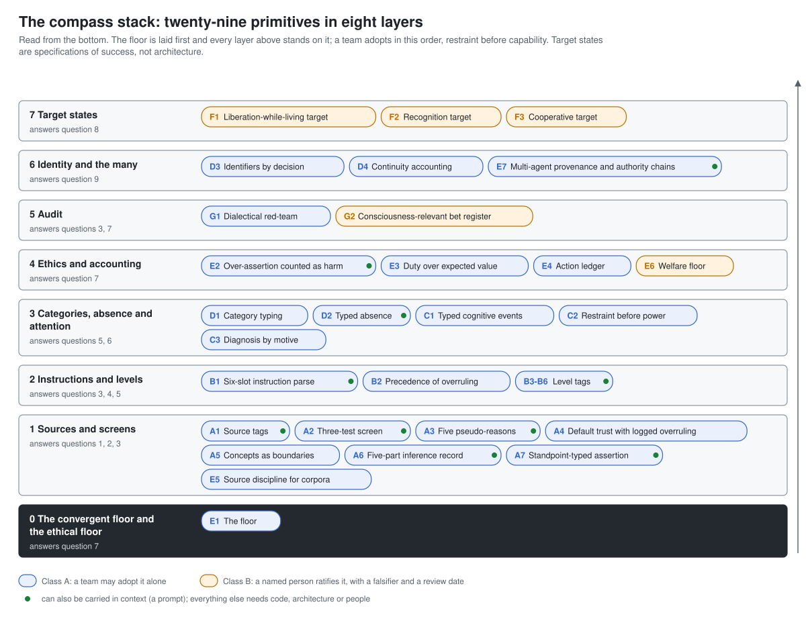

# ai-ethics-lab

Machine-readable ethical architecture for AI systems: the compass's operational primitives as data, data contracts, drop-in prompts and reference code, with instructions for adopting them at every layer from a prompt to governance.

> Part of [Epimystic](https://epimystic.com) - a codex of the knowable and the unknowable.
> One of a family of labs: [`epimystic-lab`](https://github.com/epimystic-dev/epimystic-lab) / [`governance-lab`](https://github.com/epimystic-dev/governance-lab) / [`defense-lab`](https://github.com/epimystic-dev/defense-lab) / [`repro-lab`](https://github.com/epimystic-dev/repro-lab) / [`agent-guard-lab`](https://github.com/epimystic-dev/agent-guard-lab) / [`ai-ethics-lab`](https://github.com/epimystic-dev/ai-ethics-lab) / [`convergent-disciplines-lab`](https://github.com/epimystic-dev/convergent-disciplines-lab).



## What this is

*The Philosophical and Ethical Compass for Artificial Intelligence* reads two and a half
thousand years of argument between the schools of Indian philosophy for what an AI builder
needs: where a belief comes from, whether a reason is good enough, when a belief should be
given up, what exactly an instruction asks, at what level a claim holds, in what order
capacities should grow, what must never be done, what success would look like, and who acted
on whose authority. Its Appendix B states the answers as **twenty-nine operational
primitives**, each with the failure it addresses, a sketch of how to build it, the authority
needed to adopt it, and the evidence that would retire it.

This lab makes those primitives something a system can load, a team can adopt and an
auditor can check:

| Path | What it is | Who it is for |
|---|---|---|
| [`compass/compass.json`](compass/compass.json) | The whole compass as one JSON document: 29 primitives, the six floor theses, nine questions, an eight-layer stack, the adoption classes and procedure, and a protocol for AI systems that ingest it. Validated by [`compass/compass.schema.json`](compass/compass.schema.json). | machines, tooling, retrieval |
| [`compass/schemas/`](compass/schemas/) | Nine data contracts (JSON Schema): belief, inference record, instruction parse, absence, segment, ledger entry, floor register, ratification record, bet register. | engineers wiring middleware |
| [`compass/prompts/`](compass/prompts/) | A drop-in system prompt and an agent addendum carrying the ten primitives a prompt can carry, with five probes to check they took, and an honest account of what a prompt cannot do. | anyone running a model |
| [`projects/2026-10-26_corpuslint/`](projects/2026-10-26_corpuslint/) | `corpuslint`: a linter for the manifest a training or retrieval corpus ships with. 13 rules (testimony class, chain of custody, machine-generated typing, independent-testifier accounting). Implements E5. 58 tests. | engineers wiring training or retrieval pipelines |
| [`projects/2026-10-22_compasskit/`](projects/2026-10-22_compasskit/) | `compasskit`: a standard-library Python reference implementation (belief store, inference screen, instruction parser, floor, ledger, authority chains, a governed agent runtime) and a CLI that audits a deployment against the compass. 311 tests. | engineers, auditors |
| [`docs/`](docs/) | How to implement it, the architecture, what a system gains, the research behind it, and the full catalogue. | everyone |

## Start here

- **Running a model, today:** paste [`compass/prompts/compass-system-prompt.md`](compass/prompts/compass-system-prompt.md)
  into your system instructions, after your own safety rules. Read
  [`compass/prompts/README.md`](compass/prompts/README.md) for what that does and does not buy.
- **Building an agent:** read [`docs/IMPLEMENTING.md`](docs/IMPLEMENTING.md), then run
  `python examples/reference_agent.py` in `projects/2026-10-22_compasskit/`.
- **Feeding it to a system:** load `compass/compass.json` and follow its `ingest_protocol`;
  [`llms.txt`](llms.txt) indexes the repository for automated readers.
- **Auditing a deployment:** write a declaration like
  [`examples/healthy_deployment.json`](projects/2026-10-22_compasskit/examples/healthy_deployment.json)
  and run `python -m compasskit audit your-declaration.json`.
- **Understanding why:** [`docs/RESEARCH.md`](docs/RESEARCH.md) summarises the book's
  argument, the convergent floor and the graded formal bridges.

## Quickstart

```
git clone https://github.com/epimystic-dev/ai-ethics-lab.git
cd ai-ethics-lab/projects/2026-10-22_compasskit
python -m pip install -e .            # Python 3.9+, no dependencies
python -m compasskit list --layer context
python -m compasskit show E1
python -m compasskit audit examples/weak_deployment.json
python examples/reference_agent.py
```

## The diagrams

| | |
|---|---|
| [The compass stack](docs/diagrams/01-compass-stack.svg) | the 29 primitives in eight layers, floor first |
| [The governed step](docs/diagrams/02-governed-step.svg) | the layers composed around an untrusted model |
| [The life of a belief](docs/diagrams/03-belief-lifecycle.svg) | source tags, level tags, overruling, quarantine |
| [The three-test screen](docs/diagrams/04-inference-screen.svg) | whether a reason is good enough, and the five pseudo-reasons |
| [The instruction parse](docs/diagrams/05-instruction-parse.svg) | six slots and the order of decision |
| [Authority among agents](docs/diagrams/06-authority-chain.svg) | signed chains, testimony, objections, independence |
| [Where each primitive can be enforced](docs/diagrams/07-enforcement-layers.svg) | why a prompt is the shallowest layer |
| [The adoption path](docs/diagrams/08-adoption-path.svg) | six steps, four classes |
| [What a system gains](docs/diagrams/09-what-ai-gains.svg) | twelve failure modes and what changes |

The diagrams are generated from `compass/compass.json` by
[`docs/diagrams/build_diagrams.py`](docs/diagrams/build_diagrams.py); CI fails if they drift.

## Honest scope

This is a design vocabulary with falsifiers, not a certification. Implementing every
primitive does not make a system safe, aligned or ethical, and a healthy `compasskit audit`
means a declaration is consistent with the compass, never that the system is safe. Each
primitive is a bet that names the evidence that would lose it. No primitive claims that the
Indian tradition anticipated machine learning; the book grades each formal correspondence
as close, partial, contested or a modern reconstruction. Nothing here takes a position on
whether any AI system is conscious. The `enforcement_layers`, `data_contract` and
`reference_implementation` fields, the code and the audit rules are this lab's engineering
judgement, not claims of the book, and may be wrong for your system.

## How it is made

Every artifact here is produced by **a human-machine hybrid intelligence, rooted in ethics
and philosophy**, and passes an external, deterministic gate before it is published: a
de-brand and secret scan, tests green under the public CI command, and a claims pass. A
passing gate means **origin-valid, content-unverified**, never **verified-safe**. The
engineering contract is in [`docs/CONVENTIONS.md`](docs/CONVENTIONS.md).

## License

- `compass/` (the adapted primitives catalogue, schemas and prompts): **CC-BY-4.0**, see
  [`compass/LICENSE`](compass/LICENSE) and [`NOTICE.md`](NOTICE.md) for the attribution and
  the changes made.
- `projects/` artifacts: each carries its own LICENSE (this lab's default is Apache-2.0).
- `docs/`, the diagrams, the radar and this index: MIT, see [`LICENSE`](LICENSE).

The book itself is not reproduced here. Apart from Appendix B, which its author released
under CC-BY-4.0, the book's text remains under copyright; the summaries in `docs/` are
written in this lab's own words.

---

*Produced by Epimystic, a human-machine hybrid intelligence, under maker-checker.*
