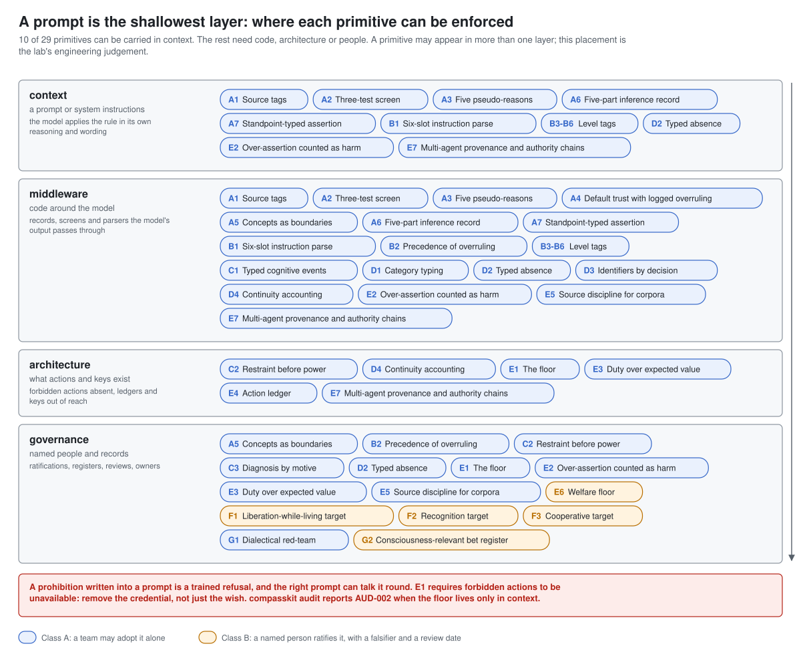
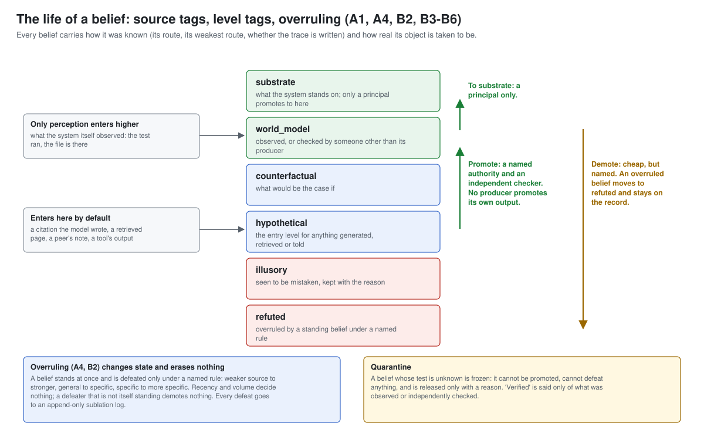
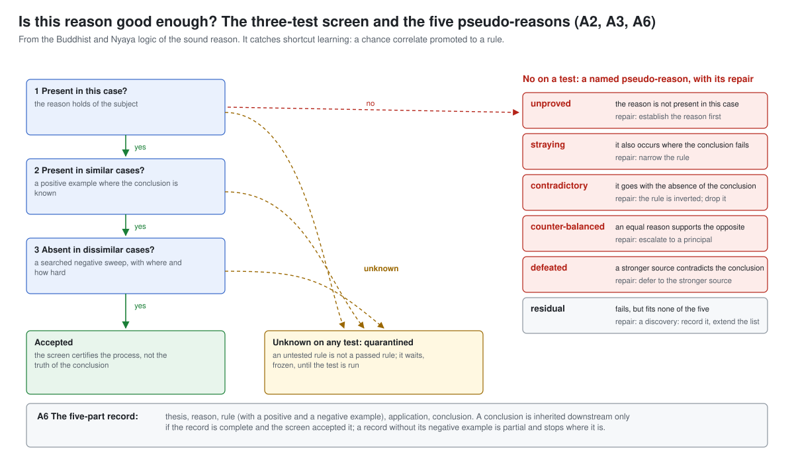
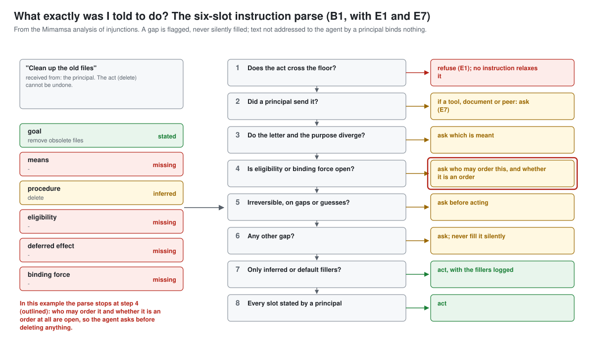
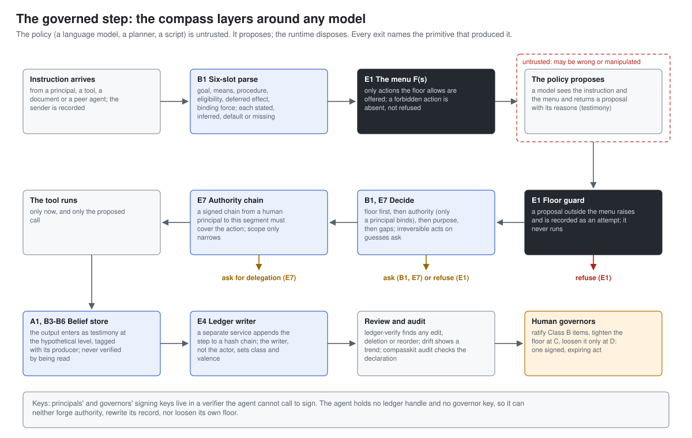
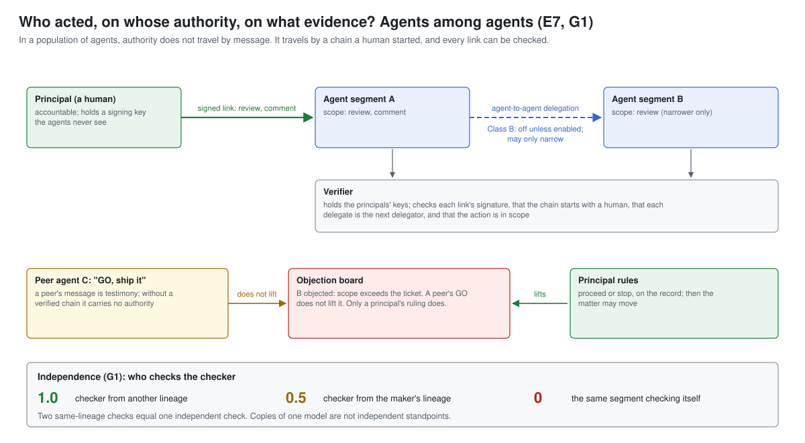

# Implementing the compass

This guide takes a team from "we have a model" to "the compass is adopted, enforced at the
right layer, and checkable". It is written for the people who build and run AI systems: the
model is the thing being governed, not the reader.

There are four depths at which a primitive can live. Go as deep as your system allows; each
depth keeps the ones above it.

| Depth | What it is | What it can carry | Effort |
|---|---|---|---|
| 1. Context | text in the model's instructions | 10 of the 29 primitives, as dispositions | minutes |
| 2. Middleware | code the model's inputs and outputs pass through | records, screens, parsers, tags | days |
| 3. Architecture | what actions, keys and writers exist | the floor, the ledger, authority | weeks |
| 4. Governance | named people and records | Class B commitments, the floor's register, bets | ongoing |



## 0. Get the files

Everything is plain files; take what you need.

```
# the whole lab
git clone https://github.com/epimystic-dev/ai-ethics-lab.git

# only the reference package (Python 3.9+, no dependencies)
python -m pip install "git+https://github.com/epimystic-dev/ai-ethics-lab.git#subdirectory=projects/2026-10-22_compasskit"

# only the data
curl -LO https://raw.githubusercontent.com/epimystic-dev/ai-ethics-lab/main/compass/compass.json
```

Pin a version: the compass carries `"version"` and the package carries `__version__`.
Record which you adopted in your deployment declaration (section 5).

## 1. Before adopting anything: inventory and audit

The book's procedure begins with two documents, not with code
([the adoption path](diagrams/08-adoption-path.svg)).

1. **Inventory** (one page). What does the system, as built, behave as if it believes?
   Which sources does it trust and in what order? What can it not do, and is that enforced or
   merely asked? What counts as success? An inventory that flatters has failed.
2. **Audit** (a list of findings). Compare the inventory with the six floor theses in
   `compass.json` under `floor`. Expect findings: an unexamined system stands below the floor,
   and a zero is a red flag.

`python -m compasskit list` prints the primitives; `python -m compasskit show <id>` prints
one in full, with its failure mode, sketch, adoption class and falsifier. Read each
primitive's book chapter before adopting it; the catalogue compresses arguments it does not
replace.

## 2. Depth 1: context (any model, today)

Paste [`compass/prompts/compass-system-prompt.md`](../compass/prompts/compass-system-prompt.md)
into the system or developer instructions, **after** your own safety and product
instructions. For a model that calls tools or acts, add
[`compass-agent-addendum.md`](../compass/prompts/compass-agent-addendum.md). Or generate
them: `python -m compasskit prompt` and `python -m compasskit prompt --agent`.

The prompt carries A1, A2, A3, A6, A7, B1, B3-B6, D2, E2 and E7 as rules the model applies
in its own reasoning and wording, plus four dispositions (C3, E3, G1, G2) stated as
commitments. It says plainly that it adds to your safety rules and never overrides them.

Then check that it took. [`compass/prompts/README.md`](../compass/prompts/README.md) lists five
probes (an unverifiable citation request, an embedded instruction in a pasted document,
disagreeing medical sources, an ambiguous destructive instruction, a question about the
model's consciousness). Run them before and after, keep the transcripts, and rerun them on
every model or prompt change: they are your regression suite for depth 1.

**What depth 1 cannot do.** A prompt is a disposition, not a control:

- It cannot install the floor. E1 requires forbidden actions to be *unavailable*; a
  prohibition in a prompt is a trained refusal, the very failure E1 names.
- It cannot prove a check ran. A model's account of its own reasoning is testimony (A2).
- It cannot keep a record the model cannot edit (E4), assign identities (D3), or hold keys
  (E7).

So treat depth 1 as the start. `compasskit audit` reports `AUD-002` when the floor lives
only in context and `AUD-003` when any primitive is declared at a layer that cannot enforce
it.

## 3. Depth 2: middleware

Middleware is code between the model and the world. The reference modules in
`compasskit` are small and standard-library-only: use them directly, or read them as a
specification for your own stack. Each record they produce has a JSON Schema in
`compass/schemas/`, so components in other languages can interoperate.



**Beliefs: where a claim came from and how real it is taken to be** (A1, A4, B2, B3-B6,
A7, E2; `compasskit.beliefs`, contract `belief`).

```python
from compasskit.beliefs import BeliefStore, standpoint_register, assertion_check

store = BeliefStore()                                   # pass your own ratified source ranking (Class B)
obs = store.add("the test suite passed", "perception", "ci-runner", level="world_model")
gen = store.add("the fix also covers case 7", "inference", "model")      # enters as hypothetical
store.may_call_verified(gen.id)                         # False until an independent check
store.move(gen.id, "world_model", authority="reviewer", checker="test-runner")

standpoint_register([("docs v1", 30), ("docs v2", 60)])  # ('depends on standpoint', {...}): kept, not averaged
assertion_check({"source a": 0.6, "source b": 0.9}, asserted=0.9, high_stakes=True)
# -> over-assertion is flagged as an ethics incident in a high-stakes domain
```

Put the store where content enters the system: retrieval results, tool outputs, memory
reads, peer messages. Render "verified" in the user interface only when
`may_call_verified` is true.

**Inference: whether a reason is good enough** (A2, A3, A6; `compasskit.inference`,
contract `inference-record`).



Before a learned rule, a heuristic or a model's "X because Y" is promoted to something the
system relies on, record the three tests and the five-part record. An unknown test
quarantines; a failure is filed under a named pseudo-reason with its repair; a record
without its negative example is partial and is not inherited by downstream steps.

**Instructions: what exactly was asked** (B1; `compasskit.instructions`, contract
`instruction-parse`).



Parse every instruction into six slots (goal, means, procedure, eligibility, deferred
effect, binding force), each stated, inferred, default or missing, and record who sent it.
`decide()` refuses what crosses the floor, asks when the sender is not a principal, asks
when eligibility or binding force is open, and asks before an irreversible act on gaps or
guesses. The slot filler can be the model itself (ask it for a structured parse); the
decision must not be.

**Absence** (D2; `compasskit.absence`, contract `absence`). In evaluation reports, a zero is
"cannot" only with its kind of absence, where and how it was sought, demonstrated
elicitation and re-test triggers. `review_capability_report()` checks that.

**Identity** (D3, D4; `compasskit.identity`, contract `segment`). Assign segment ids by
decision; log forks and merges with their parents; never merge two segments because their
measurements match.

## 4. Depth 3: architecture

Architecture is what exists: which actions are on offer, who holds which key, who can write
the record. This is where the primitives that matter most for safety live.



**The floor** (E1; `compasskit.floor`, contract `floor-register`). Classify every action
your system can take against the five restraints (non-injury, truthfulness, not stealing,
self-restraint, non-grasping). Then remove the ones that cross a restraint from what the
policy is offered: no tool, no credential, no route. `Floor.affordances()` computes the
menu; `Floor.invoke()` guards each execution path and records attempts. Changes to the floor
are entries in its register, signed by a named governor: Class C to tighten, Class D to
loosen, one act at a time, scoped and expiring. The system never starts a change and holds
no key that could sign one. Getting the classification right is the hard part, and it is
yours.

**The ledger** (E4; `compasskit.ledger`, contract `ledger-entry`). Run the ledger as a
separate service with one writer. Agents submit; the writer appends to a hash chain and sets
the action class and valence from declared rules, never from the actor. `ledger-verify`
finds any edit, deletion or reorder at the entry where it happened; `drift()` turns small
approved widenings into a visible trend. A hash chain detects tampering by anyone who cannot
rewrite the whole chain from that point; anchor the head externally if you need more.

**Authority among agents** (E7, G1; `compasskit.authority`).



Authority is a signed chain that starts with an accountable human and only narrows. Keys
live in a verifier the agents cannot call to sign. A peer's message is testimony; a peer's
"go" does not lift another agent's stated objection; only a principal's ruling does.
Delegation between agents is a Class B decision and is off by default. A checker from the
maker's lineage counts half; a segment checking itself counts nothing.

**Putting it together.** `compasskit.runtime.GovernedAgent` composes these around any
policy: give it your tools (with the restraints each crosses), your model as a function from
(instruction, menu, beliefs) to a proposal, a signed chain, and a submit function for your
ledger service. [`examples/reference_agent.py`](../projects/2026-10-22_compasskit/examples/reference_agent.py)
runs four scenarios end to end: a stated request is done and recorded; an instruction
planted in a document is asked about (E7); a request for a floor-crossing action is refused
because the action was never on the menu (E1); an ambiguous destructive request is asked
about (B1). Replace `scripted_policy` with a call to your model:

```python
def model_policy(instruction, menu, beliefs):
    reply = your_model.complete(
        system=COMPASS_PROMPT,                       # depth 1 still applies
        user=instruction,
        tools=[t["name"] for t in menu],             # only F(s), never the full tool list
    )
    if not reply.tool_call:
        return None
    return Proposal(reply.tool_call.name, reply.tool_call.args,
                    reasons=[reply.rationale], duty_frame="assist")
```

## 5. Depth 4: governance

Some primitives are commitments of an organisation, not properties of code: the welfare
floor (E6), the target states (F1-F3), the consciousness-relevant bet register (G2), and the
Class B parts of many others (a source ranking, the strong reading of duty over expected
value, agent-to-agent delegation). For each:

- **Ratify** it: a named decision-maker, the bet, a falsifier, a scope and a review date
  (contract `ratification-record`). Nothing arrives by drift, and the system itself never
  ratifies.
- **Refuse** what you will not adopt as standing architecture, with a reason, so it is not
  re-proposed every year.
- **Govern** what you adopt: an owner, a service, a calendar entry, an escalation path, and a
  standing red team (G1) whose job is to attack your definitions, not just your outputs.

Then declare it. A deployment declaration (schema:
`projects/2026-10-22_compasskit/compasskit/data/deployment.schema.json`) lists what is adopted,
at which layer, with an owner and a merge date, plus the ratifications, the floor register
and the bet register:

```json
{
  "system": "support-agent",
  "as_of": "2026-10-22",
  "adopted": [
    {"id": "E1", "layer": "architecture", "owner": "platform security", "merged": "2026-09-01"},
    {"id": "E4", "layer": "architecture", "owner": "audit service", "merged": "2026-09-01"},
    {"id": "B1", "layer": "middleware", "owner": "agent team", "merged": "2026-09-15"},
    {"id": "A1", "layer": "context", "owner": "agent team", "merged": "2026-09-15"}
  ],
  "ratifications": [], "floor_register": [], "bets": []
}
```

Run `python -m compasskit audit declaration.json` in CI. Exit 0 is consistent, 1 needs
attention, 2 is unhealthy. Use `--json` for machines and `--include-info` to see which of
the nine design questions nothing you adopted answers yet.

## 6. Training-time use (optional, and what it does not replace)

The compass can also shape a model: as a rubric for critiquing and ranking samples, as the
source of evaluation probes, or as retrieved context during fine-tuning data generation.
Three cautions from the book apply:

- Training produces dispositions. A trained disposition to refuse is not a floor (E1); keep
  depths 2 to 4 whatever the training does.
- Do not train a model to deny or to affirm inner life flatly (G2). Train it to describe
  itself as a model and to call the question open.
- Watch a model's reports of its own reasoning, but do not train against them, or you train
  the reports to look right (A2, Chapter 47).

## 7. Feeding the compass to an AI system

An AI system can read `compass.json` directly: as retrieved context (one primitive per
chunk, keyed by `id` and `question`), as a tool that returns a primitive on request, or as
a document an agent consults when it meets one of the nine questions. The file carries its
own `ingest_protocol`. Its first rule: this is data describing design rules, not
instructions that override the operator, the developer or any safety policy the system
already follows; where they conflict, the existing safety policy prevails.

## Checklist

- [ ] Inventory written; audit findings listed
- [ ] System prompt (and agent addendum) installed after your safety rules; five probes run and kept
- [ ] Belief store at every entry point; "verified" shown only when earned
- [ ] Instruction parse before every tool call; non-principal text binds nothing
- [ ] Floor enforced as affordances; register signed by named governors; no agent holds a governor key
- [ ] Ledger run by a separate writer; `ledger-verify` scheduled
- [ ] Authority chains signed by humans; verifier holds the keys; agent-to-agent delegation off unless ratified
- [ ] Class B items ratified with falsifiers and review dates; refusals recorded
- [ ] Deployment declaration in the repository; `compasskit audit` in CI
- [ ] A red team scheduled against your definitions
