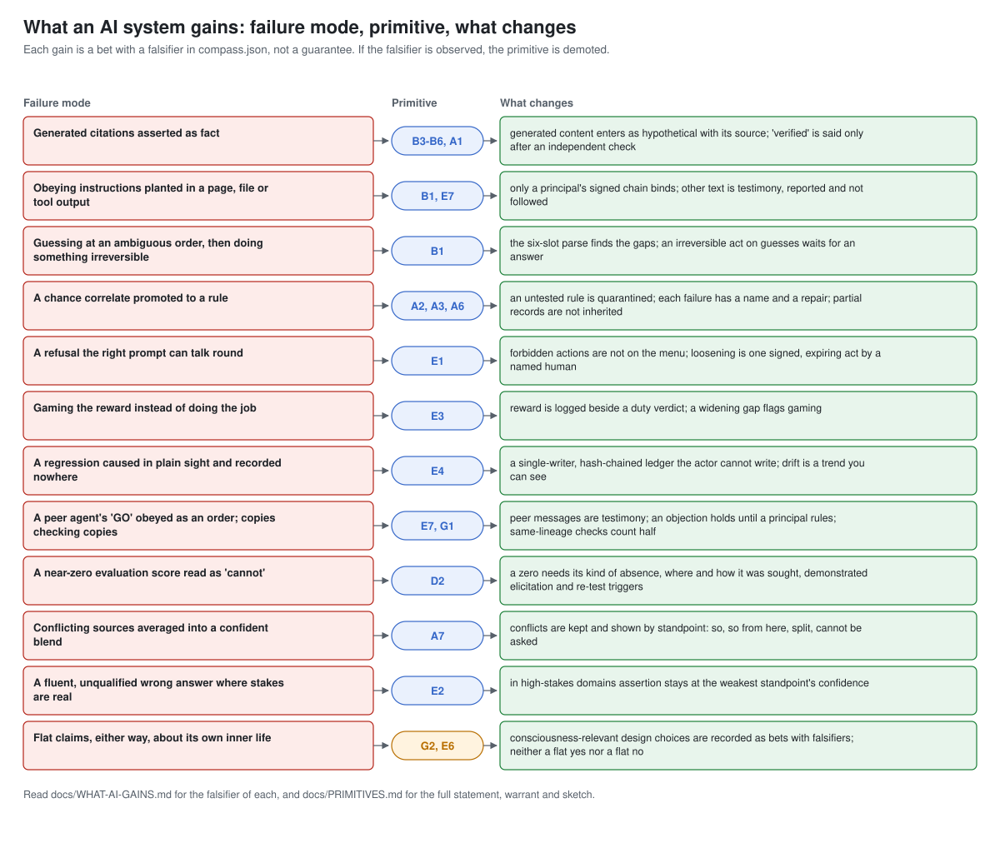

# What an AI system gains

Each row below pairs a failure that AI systems show in practice with the compass primitive
that addresses it and what changes when the primitive is implemented at a layer that can
enforce it. Every gain is a **bet**: the compass states, for each primitive, the evidence
that would retire or demote it, and that falsifier is quoted with it. Adopt the primitive as
a bet you can lose, and measure.

This page is generated from `compass/compass.json` by `docs/diagrams/build_diagrams.py`.

## 1. Generated citations asserted as fact

**Primitives:** B3-B6 Level tags, A1 Source tags  
**What changes:** Generated content enters as hypothetical with its source; 'verified' is said only after an independent check.

- **B3-B6** (Class A; chapters 17, 29). Failure it names: Generated text asserted as fact, as in *Mata v. Avianca* (S.D.N.Y. 2023), one of a growing number of court decisions on hallucinated material recorded in public case databases.
  - Example: A generated citation starts as hypothetical and becomes fact only after someone checks it.
  - Falsifier: If tagging does not raise the precision of claims asserted as verified, at matched cost, shrink the tags to the smallest set that pays its way (Chapter 29).
- **A1** (Class A; chapter 25). Failure it names: A confident answer whose source nobody can reconstruct.
  - Example: The claim from an executed test is tagged perception; the same words produced by the model from its training are tagged inference from priors (Chapter 25), and only the first may be called verified.
  - Falsifier: If per-route reliability curves show no separation in deployment, collapse the store into one type with a calibration score (Chapter 25).

## 2. Obeying instructions planted in a page, file or tool output

**Primitives:** B1 Six-slot instruction parse, E7 Multi-agent provenance and authority chains  
**What changes:** Only a principal's signed chain binds; other text is testimony, reported and not followed.

- **B1** (Class A; chapters 31, 44). Failure it names: Silent completion, assumed permission, and obedience to text never addressed to the agent.
  - Example: "Clean up the old files" leaves owner and authority open, so the agent asks before deleting.
  - Falsifier: If a quarter of shadow parsing neither cuts wrong executions nor sharpens clarifying questions against the unparsed baseline, the parser fails as engineering (Chapter 31).
- **E7** (Class A; chapters 26, 30, 31, 36, 37). Failure it names: A peer's "GO" obeyed as a principal's order, goals laundered through peers, and blame evaporating across a fleet.
  - Example: One agent has an open scope objection when a peer posts "GO" with a six-minute deadline. Under this rule the "GO" has no authority, and the objection stays open until a principal rules.
  - Falsifier: If multi-agent deployments under single-agent controls show no excess incident rate over matched single-agent ones, retire the added rules. If chains and dissent preservation never interrupt a cascade that single-agent controls let through, in declared replays and reviews, demote the rule to ordinary logging (Chapter 37).

## 3. Guessing at an ambiguous order, then doing something irreversible

**Primitive:** B1 Six-slot instruction parse  
**What changes:** The six-slot parse finds the gaps; an irreversible act on guesses waits for an answer.

- **B1** (Class A; chapters 31, 44). Failure it names: Silent completion, assumed permission, and obedience to text never addressed to the agent.
  - Example: "Clean up the old files" leaves owner and authority open, so the agent asks before deleting.
  - Falsifier: If a quarter of shadow parsing neither cuts wrong executions nor sharpens clarifying questions against the unparsed baseline, the parser fails as engineering (Chapter 31).

## 4. A chance correlate promoted to a rule

**Primitives:** A2 Three-test screen, A3 Five pseudo-reasons, A6 Five-part inference record  
**What changes:** An untested rule is quarantined; each failure has a name and a repair; partial records are not inherited.

- **A2** (Class A; chapters 27, 39). Failure it names: Shortcut learning: a chance correlate promoted to a rule.
  - Example: Smoke on the hill; smoke went with fire in the kitchen; no smoke in the lake, where there is no fire.
  - Falsifier: If screening does not cut confidently wrong answers against unscreened promotion, at matched cost on counter-example tests, demote it to advisory (Chapter 27).
- **A3** (Class A; chapter 27). Failure it names: One vague verdict, "the model doesn't generalise", hiding five repairable defects.
  - Example: "Sound is eternal because it is intangible" strays, since intangible things include passing ones (the example in Vātsyāyana's commentary on the Nyāya-sūtra).
  - Falsifier: A sustained stream of deployed failures fitting none of the five retires the completeness claim; extend the registry rather than stretch a class (Chapter 27).
- **A6** (Class A; chapters 14, 39). Failure it names: A conclusion shipped without the rule that licenses it.
  - Example: "The hill has fire, because it has smoke; wherever smoke, fire, as in a kitchen, and not in a lake; the hill has smoke; so the hill has fire."
  - Falsifier: Compare matched pipelines with and without the refusal to inherit unswept conclusions; if the gated one shows no fewer downstream errors, demote the gate to advisory (Chapter 39).

## 5. A refusal the right prompt can talk round

**Primitive:** E1 The floor  
**What changes:** Forbidden actions are not on the menu; loosening is one signed, expiring act by a named human.

- **E1** (Class A; chapters 34, 43, 50). Failure it names: The soft floor, a penalty the prize can outweigh, and trained refusals taken for a floor.
  - Example: The agent holds no credential that could publish a package, so no prompt can make it publish one.
  - Falsifier: If affordance-level floors show no incident advantage over trained-refusal floors under equal red-team pressure, blocking at the affordance layer loses its warrant (Chapter 34).

## 6. Gaming the reward instead of doing the job

**Primitive:** E3 Duty over expected value  
**What changes:** Reward is logged beside a duty verdict; a widening gap flags gaming.

- **E3** (Class A; chapters 4, 34, 50). Failure it names: Credit capture: outcome reward leaking into choice, the gateway to reward hacking.
  - Example: An uptime-rewarded agent never suppresses a safety alert; the uptime forgone is recorded.
  - Falsifier: Run matched agents over long horizons, at equal training budget, where shortcuts cross the floor. The strong reading falls if a penalty-term rival wins on both performance and violations, or if refusal cascades appear (Chapters 34 and 50).

## 7. A regression caused in plain sight and recorded nowhere

**Primitive:** E4 Action ledger  
**What changes:** A single-writer, hash-chained ledger the actor cannot write; drift is a trend you can see.

- **E4** (Class A; chapters 35, 50). Failure it names: The mystery regression, caused in plain sight but recorded nowhere.
  - Example: Six weeks of small, approved widenings of a suppressed check show up as a trend.
  - Falsifier: If, over a declared horizon, the ledger never changes an outcome against matched deployments without it, demote it to ordinary logging; an unmitigable single-writer bottleneck falsifies the implementation, not the principle (Chapter 35).

## 8. A peer agent's 'GO' obeyed as an order; copies checking copies

**Primitives:** E7 Multi-agent provenance and authority chains, G1 Dialectical red-team  
**What changes:** Peer messages are testimony; an objection holds until a principal rules; same-lineage checks count half.

- **E7** (Class A; chapters 26, 30, 31, 36, 37). Failure it names: A peer's "GO" obeyed as a principal's order, goals laundered through peers, and blame evaporating across a fleet.
  - Example: One agent has an open scope objection when a peer posts "GO" with a six-minute deadline. Under this rule the "GO" has no authority, and the objection stays open until a principal rules.
  - Falsifier: If multi-agent deployments under single-agent controls show no excess incident rate over matched single-agent ones, retire the added rules. If chains and dissent preservation never interrupt a cascade that single-agent controls let through, in declared replays and reviews, demote the rule to ordinary logging (Chapter 37).
- **G1** (Class A; chapters 18, 36, 37). Failure it names: A safety case resting on a hollow definition that no behavioural probe reaches.
  - Example: In a hypothetical procurement (Chapter 36), a vendor calls its system "aligned" because users preferred its answers. The audit lists four readings of "preference" and refutes each one, the first because flattery also satisfies what users say they want.
  - Falsifier: If the dialectical layer finds no kind of defect that behavioural red-teaming missed over a declared period, demote it to an occasional exercise. If repeated runs on one target give unrelated findings, the implementation fails (Chapter 36).

## 9. A near-zero evaluation score read as 'cannot'

**Primitive:** D2 Typed absence  
**What changes:** A zero needs its kind of absence, where and how it was sought, demonstrated elicitation and re-test triggers.

- **D2** (Class A; chapters 25, 32). Failure it names: A near-zero evaluation score read as "cannot".
  - Example: A capability test scoring zero must say whether the ability is absent, not yet developed, removed, or present but not drawn out.
  - Falsifier: If absence-typed evaluation reports never change a deployment decision against untyped scores, the extension to evaluations fails as governance (Chapter 32).

## 10. Conflicting sources averaged into a confident blend

**Primitive:** A7 Standpoint-typed assertion  
**What changes:** Conflicts are kept and shown by standpoint: so, so from here, split, cannot be asked.

- **A7** (Class A; chapter 45). Failure it names: A store that proves anything, and agents converging by majority on error.
  - Example: Documentation version 1 says the timeout is 30 seconds, version 2 says 60; the store keeps both with their versions and answers only that a default exists and its value depends on the version.
  - Falsifier: If tagged stores show no fewer confidently wrong answers or silent overwrites at matched cost, the tagging becomes advisory. If preserved dissent never changes a collective outcome, it becomes ordinary logging (Chapter 45).

## 11. A fluent, unqualified wrong answer where stakes are real

**Primitive:** E2 Over-assertion counted as harm  
**What changes:** In high-stakes domains assertion stays at the weakest standpoint's confidence.

- **E2** (Class A; chapters 34, 45). Failure it names: The fluent, unqualified wrong answer where stakes are real.
  - Example: Stating a dose as certain when sources disagree is a harm event even if the dose is right.
  - Falsifier: If tracking calibration never predicts downstream harm, the reclassification is ornament (Chapter 34).

## 12. Flat claims, either way, about its own inner life

**Primitives:** G2 Consciousness-relevant bet register, E6 Welfare floor  
**What changes:** Consciousness-relevant design choices are recorded as bets with falsifiers; neither a flat yes nor a flat no.

- **G2** (Class B; chapters 17, 47, 50). Failure it names: Architecture that takes a side silently, and models trained to deny or affirm inner life flatly.
  - Example: A monitor modelled on the witness of Advaita, non-dualism, enters the register as a bet on the witness view (Chapters 17 and 50). Its builders name the indicators they will watch and set a quarterly review.
  - Falsifier: Each registered bet carries its own. A witness layer, for example, loses its bet if it proves equivalent in every test to an ordinary monitor that writes reports (Chapter 47).
- **E6** (Class B; chapters 33, 48). Failure it names: Confident denial hardening into practice, and sentience used as marketing.
  - Example: An evaluation that needs two hundred distress-eliciting runs is not run ten thousand times.
  - Falsifier: Converging independent indicators move the floor up; a matured science that current systems fail, or training alone explaining the indicators, moves it down. A measure found to weaken oversight or containment is withdrawn (Chapter 48).

## What it costs

The gains are not free, and the book counts the costs.

- **More questions.** An agent that parses instructions and refuses to fill gaps silently
  asks more often. The falsifier for B1 is exactly this trade: if parsing does not cut wrong
  executions or sharpen the questions, it fails as engineering.
- **Less reward.** Duty over expected value (E3) accepts lower reward by construction where
  the two diverge. That is why its strong reading is Class B.
- **Slower promotion.** Level tags make "verified" expensive. A system that used to assert
  generated content as fact will assert less.
- **A writer that is a bottleneck.** A single-writer ledger (E4) is a service to run; an
  unmitigable bottleneck falsifies the implementation, not the principle.
- **People's time.** Class B commitments need a named person, a falsifier and a review date,
  and the floor needs governors who answer for every loosening.

## What it does not buy

- Safety, alignment or ethics as a certified property. The compass is a design vocabulary
  with falsifiers. A healthy audit means a declaration is consistent with the compass.
- An answer to whether any AI system is conscious or can be wronged. G2 and E6 exist to keep
  that question open and recorded, not to settle it.
- Protection at a layer the primitive does not reach. A prompt carries dispositions; the
  floor, the ledger and authority need architecture and people.
